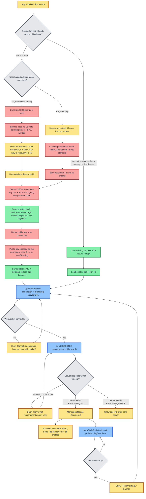
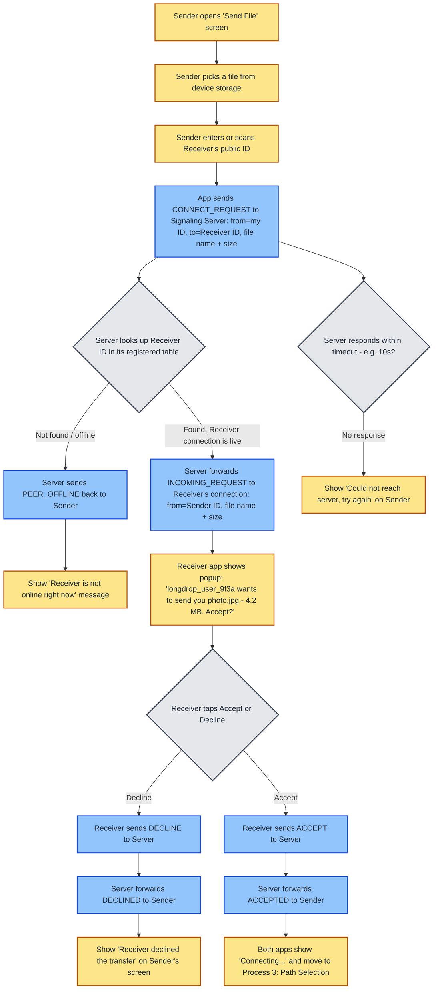

# Architecture

Longdrop is made of **two separate codebases**.

## 1. The App (this repo)

Flutter, runs on the phone. Contains both:

- **Frontend** — screens, buttons, progress bar.
- **Backend logic (in-app)** — key generation, encryption, chunking, WebRTC.

> The in-app backend logic (`lib/backend/`) is written by hand by the project owner. AI assistants should not write or modify it. See [AGENTS.md](../AGENTS.md).

## 2. The Server (separate repo, runs on a VPS)

- **Signaling API (WebSocket)** — register, find-peer, pass connection info.
- **TURN relay** — backup path only, used when a direct P2P connection fails (~10–20% of real-world cases).

The server never stores or reads file data.

## Identity model

- On install, the phone generates a key pair locally from a random 128-bit seed. The private key never leaves the device.
- The public key is the permanent user ID, shared like a phone number/contact.
- **Recovery (added 2026-10-25):** the seed is also encoded as a 12-word BIP39 backup phrase, shown once at first launch. The user must write it down. On reinstall, entering the phrase regenerates the exact same seed, keys, and ID — contacts don't need to be re-shared. Losing the phrase AND the device still means permanent loss of that ID (no server-side recovery, by design).

### Process 1 diagram — Registration

Color key: 🟡 UI/app state · 🔴 Crypto (owner-written backend) · 🔵 Network/signaling · 🟢 Local storage · ⚪ Decision point



## How a file transfer works (no middleman for the file)

1. Each phone asks a STUN server "what's my real public address?" (NAT traversal).
2. Both phones send their address to each other via the signaling server. Only addresses pass through the server, never the file.
3. The phones connect directly; the file flows phone-to-phone, end-to-end encrypted.
4. If the direct connection fails (strict NAT/firewall), it falls back to the TURN relay, which passes the encrypted data through blind (it cannot read it).

### Process 2 diagram — Connection Setup

Same color key as above. This runs after both sender and receiver have completed Process 1 (Registration).



## Known v1 limitation

Both sender and receiver must keep the app open and online for the whole transfer. Closing the app, losing connection, or the OS killing the app in the background makes the transfer fail, and it must be restarted.

Accepted for v1. Resume support and/or async transfer (server-stored encrypted blob) are considered for v2.

## Staying alive during a transfer (added 2026-10-25)

Mobile OSes aggressively suspend or kill backgrounded apps to save battery, which would silently drop the signaling WebSocket and any active WebRTC transfer. To prevent this during an active transfer:

- **Android:** run a foreground service with a persistent notification (e.g. "Longdrop: sending photo.jpg — 45%") while a transfer is in progress. This is the same mechanism apps like WhatsApp/Signal use to survive calls in the background.
- **iOS:** equivalent background task/VoIP-style entitlement as needed (details TBD when iOS build is tackled — Android is first).
- Outside of an active transfer, the app does NOT hold a foreground service — only while sending or receiving.

## Reconnection behavior

The "online" state is not a flag the app sets — it is simply whether the signaling WebSocket to the server is currently open. If the connection drops (backgrounding without the foreground service, network loss, server restart, etc.), the server removes the user from its live-connections table immediately.

On resume (app foregrounded again, or foreground service keeps it alive), the app must:
1. Detect the WebSocket is closed.
2. Reconnect and re-send the REGISTER message automatically, with no user action needed.
3. If this happens mid-transfer and the foreground service did NOT keep the connection alive, the transfer is lost per the v1 limitation above and must restart from Process 2 (Connection Setup).

## Code structure / state management

The app uses [Riverpod](https://riverpod.dev) (`flutter_riverpod`) as the state-management layer between the backend and the UI.

```
lib/
├── backend/     # owner-written logic: crypto, signaling, WebRTC (plain Dart)
├── providers/   # Riverpod seam: wraps backend services, exposes watchable state
├── screens/     # full-page UI (Home, My ID, Send, Receive)
├── widgets/     # reusable UI pieces
└── main.dart    # app root, wrapped in ProviderScope
```

- **`lib/backend/`** — the project owner's own code. Plain Dart with zero Flutter/UI imports. Owns all crypto, signaling and WebRTC logic. AI assistants must not touch this layer's logic (see [AGENTS.md](../AGENTS.md)); only the provider wiring that wraps it lives elsewhere.
- **`lib/providers/`** — the Riverpod seam. Wraps backend services as providers and exposes state that screens can watch.
- **`lib/screens/` and `lib/widgets/`** — UI. They only ever import `lib/providers/`, never `lib/backend/` directly.
