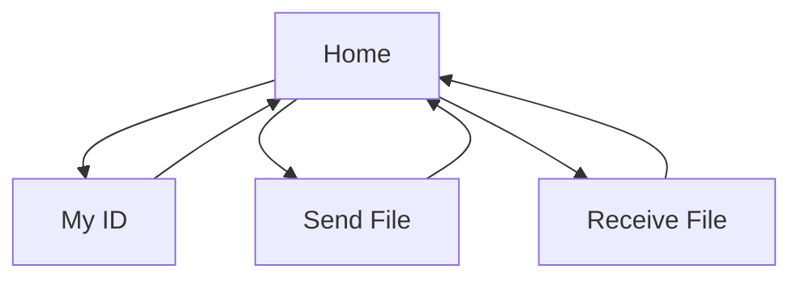

# Pages (frontend, v1)

| Page | Purpose |
|------|---------|
| **Home** | App bar "Longdrop"; links to My ID / Send File / Receive File. |
| **My ID** | Shows the user's public key (placeholder for now) with a "Share" action. |
| **Send File** | Pick a file, enter/scan the peer's ID, connect, progress bar. |
| **Receive File** | Waiting/listening state, incoming request, accept, progress bar. |

No accounts, no history, and no settings beyond a "keep app open" warning banner shown during transfer.

## Navigation flow

Each page is reached from Home and returns to Home (back navigation).

## Current state

All four screens exist as placeholder UI with navigation in `lib/screens/`. They are not yet wired to real backend logic.
